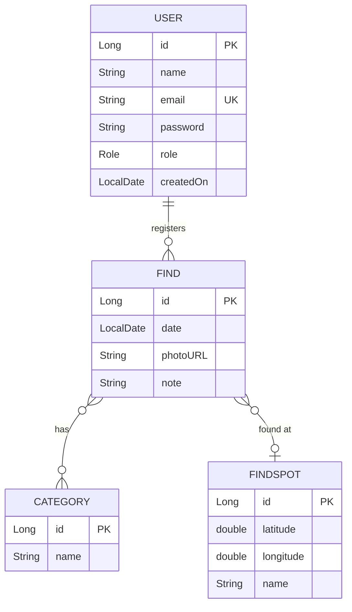

# The Collector

## Vision

The Collector is a backend API for rock collectors who want to document their finds. Users can register finds with photos, notes, dates, categories and find spots, and keep their personal collection in one place.

This project is my third-semester backend portfolio project for my AP degree in Computer Science.

---

## Links

Portfolio website:
https://kabskov.github.io/Portfolio/

Deployed application:
https://katarinakrogh.dk

Source code repository:
https://github.com/kabskov/the-collector

---

# Architecture

## System Overview

The project is a layered backend:

- **Controller layer**: REST endpoints (Javalin) that read the request and return the response
- **Service layer**: business logic and validation
- **DAO layer**: database access with JPA/Hibernate
- **DTOs and mappers**: the API never exposes entities directly; mappers convert between entities and DTOs

Technologies used:

- Java
- Javalin
- JPA / Hibernate
- PostgreSQL
- Maven
- JWT authentication (with BCrypt-hashed passwords)
- Logback / SLF4J
- JUnit, Hamcrest, Testcontainers and Rest Assured for testing
- Docker, Docker Compose, Caddy, Watchtower and GitHub Actions for deployment

## Architecture Diagram

```
Client → Caddy (HTTPS) → Javalin Controller → Service → DAO → PostgreSQL
                                                  ↓
                                        Nominatim (OpenStreetMap)
```

## Key Design Decisions

**Authentication and authorization**

Users log in with email and password and receive a JWT, which is valid for 1 hour. The token must be sent as `Authorization: Bearer <token>` on all protected endpoints. Every route has a role (`ANYONE` or `USER`), and two `before`-handlers check the token and the role. On routes with a `userId` in the path, `requireOwner` makes sure the user can only access their own data. When creating a find, the user id is taken from the token and not from the request body, so a user cannot register finds on someone else's account.

**Passwords**

Passwords are hashed with BCrypt. They can be sent to the API but are never returned in a response.

**Error handling**

All business errors are thrown as an `ApiException` with a status code and a message. One central exception handler turns them into a common JSON format: `{ "status": 404, "msg": "..." }`. Login uses the same message for "unknown email" and "wrong password", so the API cannot be used to find out which emails have an account. A find that belongs to another user returns 404, not 403, so ids of other users' finds are not revealed.

**External API**

When a find is registered with a find spot keyword, the service looks the place up using the Nominatim API (OpenStreetMap) and stores the name and coordinates. Nominatim only allows one request per second, so the service waits one second before each call.

**Logging**

Logback writes to both the console and a daily rolling file (`logs/app.log`, kept for 14 days). Successful key events (user created, login, find created) are logged at `INFO`. `ApiException` logs client errors (4xx) at `WARN` and server errors (5xx) at `ERROR` with the stack trace. Passwords and tokens are never logged.

**Deployment pipeline**

```
git push to main → GitHub Actions (build + Docker image) → Docker Hub → Watchtower on the droplet pulls the new image → container restarts
```

On the DigitalOcean droplet, Docker Compose runs four services: PostgreSQL, the API, Caddy (reverse proxy with automatic HTTPS) and Watchtower. The API container has a healthcheck (`/api/v1/auth/healthcheck`), and Caddy only starts when the API is healthy. Secrets are kept in a `.env` file on the server and are not part of the repository.

## Scope and Limitations (version 1)

I kept the scope small to focus on quality over quantity:

- The application is for personal use. A user's finds are never shared with other users.
- You must create an account and be logged in to use the application.
- A find spot is registered by typing a place name, not by using GPS or a map.
- Categories are predefined: hagstones, fossils, pretty stones, flint stones, skipping stones, sea glass, quartz, other.
- The user can list all their finds, but the API has no endpoints for filtering or sorting yet.
- **Image upload is not implemented.** A find has a required `photoURL`, but there is no endpoint for uploading a file. I wanted this in version 1, but did not get to it.

---

# Data Model

## ERD



## Important Entities

### User

Represents a registered user. The role is `USER` for everyone who registers. A user's finds are removed together with the user.

Fields: id, name, email (unique), password (BCrypt hash), role, createdOn

### Find

Represents a single stone find registered by a user. A find belongs to one user, has one or more categories and optionally a find spot.

Fields: id, date, photoURL, note, user, categories, findSpot

### Category

A predefined type of stone (for example hagstone or fossil). Categories are shared between all users.

Fields: id, name

### FindSpot

The place where a find was made, looked up from a keyword via Nominatim.

Fields: id, latitude, longitude, name

---

# API Documentation

Base URL: `https://katarinakrogh.dk/api/v1`

Protected endpoints require the header `Authorization: Bearer <token>`.

| Method | URL | Role | Request body | Response (status) | Errors |
|---|---|---|---|---|---|
| GET | / | ANYONE | | JSON with name, version, healthcheck path and repository link (200) | |
| GET | /auth/healthcheck | ANYONE | | `{"msg": "API is up and running"}` (200) | |
| POST | /auth/login | ANYONE | LoginDTO | TokenDTO (200) | 400, 401 |
| GET | /categories | ANYONE | | [CategoryDTO] (200) | |
| POST | /users | ANYONE | UserDTO | UserDTO (201) | 400, 409 |
| GET | /users/{userId} | USER | | UserDTO (200) | 401, 403 |
| POST | /finds | USER | FindDTO | FindDTO (201) | 400, 401, 404, 502 |
| GET | /users/{userId}/finds | USER | | [FindDTO] (200) | 401, 403 |
| GET | /users/{userId}/finds/{findId} | USER | | FindDTO (200) | 401, 403, 404 |
| PATCH | /users/{userId}/finds/{findId} | USER | FindDTO (partial) | FindDTO (200) | 400, 401, 403, 404 |
| DELETE | /users/{userId}/finds/{findId} | USER | | No body (204) | 401, 403, 404 |

## Request and response formats

**Index** (response)

```json
{
  "name": String,
  "version": String,
  "healthcheck": String,
  "repository": String
}
```

**LoginDTO** (request)

```json
{
  "email": String,
  "password": String
}
```

**TokenDTO** (response)

```json
{
  "token": String,
  "userId": Number
}
```

**CategoryDTO**

```json
{
  "id": Number,
  "name": String
}
```

**UserDTO**

When creating a user, send `name`, `email` and `password`. The role is always set to `USER` by the server.

```json
{
  "id": Number,
  "name": String,
  "email": String,
  "password": String (request only, never returned),
  "role": String (response only),
  "createdOn": String (yyyy-MM-dd)
}
```

**FindDTO**

```json
{
  "findId": Number,
  "date": String (yyyy-MM-dd),
  "note": String,
  "photoURL": String,
  "userId": Number,
  "categoryIds": [Number],
  "findSpotKeyword": String,
  "findSpotName": String
}
```

- **POST /finds:** `date` is required and must be written as `yyyy-MM-dd`, for example `2026-07-12`. `photoURL` and at least one id in `categoryIds` are also required. `note` and `findSpotKeyword` are optional. The user id comes from the token. `findId` and `findSpotName` are set by the server.
- **PATCH:** All fields are optional, and only the fields that are sent are changed. If `categoryIds` is sent, it replaces the old list and must not be empty. The find spot cannot be changed after the find has been created.
- **Responses:** `findSpotName` is `null` if the find has no find spot, `note` is an empty string if no note was given, and `findSpotKeyword` is always `null`.

## Errors

All errors use the same format:

```json
{ "status": Number, "msg": String }
```

| Status | Example messages | When |
|---|---|---|
| 400 | "Name is required", "Email is required", "Password is required", "Date is required", "Photo URL is required", "A find must have at least one category" | Missing or invalid input |
| 401 | "Wrong email or password", "Missing token", "Invalid or expired token" | Login fails, or the token is missing or invalid |
| 403 | "Forbidden" | Wrong role, or the `userId` in the URL is not your own |
| 404 | "Find with id X not found", "Category with id X not found", "No location found for keyword: X" | The resource does not exist (or belongs to another user) |
| 409 | "Email already in use" | The email is already registered |
| 502 | "External API returned status X" | The find spot lookup (Nominatim) fails |

---

# User Stories

| # | User story | Status |
|---|---|---|
| 1 | As a rock collector, I want to create an account, so I can register my finds. | Done |
| 2 | As a rock collector, I want to log in, so I can see my own finds. | Done |
| 3 | As a rock collector, I want to register a find, so I can keep track of what I have found. | Done |
| 4 | As a rock collector, I want to choose a category for my find, so my finds are easy to sort. | Done |
| 5 | As a rock collector, I want to see a list of all my finds, so I get an overview of my collection. | Done |
| 6 | As a rock collector, I want to edit a find, so I can correct it if I made a mistake. | Done |
| 7 | As a rock collector, I want to delete a find, so my collection only contains what I want to keep. | Done |
| 8 | As a rock collector, I want to add a find spot to my find, so I can see where I made my finds. | Done |
| 9 | As a rock collector, I want to add a date to my find, so I can see when I found it. | Done |
| 10 | As a rock collector, I want to add a note to my find, so I can connect a thought or an event to it. | Done |
| 11 | As a rock collector, I want to upload a picture of my find, so I can recognize it in my collection. | Partly: a `photoURL` is stored, but file upload is not implemented |

## Acceptance criteria

<details>
<summary>Show acceptance criteria (Given / When / Then)</summary>

**1. Create an account**

- **Given** I do not have an account, **when** I create a user with name, email and password, **then** I get 201 and my details without the password.
- **Given** I do not have an account, **when** I create a user without name, email or password, **then** I get 400.
- **Given** the email is already in use, **when** I create a user with that email, **then** I get 409.

**2. Log in**

- **Given** I have an account, **when** I log in with the correct email and password, **then** I get 200 with a token and my user id.
- **Given** I have an account, **when** I log in with the wrong password, **then** I get 401 "Wrong email or password".
- **Given** the email does not exist, **when** I log in, **then** I get the same 401 as for a wrong password.
- **When** I log in without email or password, **then** I get 400.

**3. Register a find**

- **Given** I am logged in, **when** I register a find with date, photo URL and at least one category, **then** I get 201 and the find is linked to me.
- **Given** I am not logged in, **when** I register a find, **then** I get 401.

**4. Choose a category**

- **Given** I am not logged in, **when** I fetch the categories, **then** I get 200 with the list.
- **Given** I am logged in, **when** I register a find without categories, **then** I get 400.
- **Given** I am logged in, **when** I register a find with a category that does not exist, **then** I get 404.

**5. See my finds**

- **Given** I am logged in and have finds, **when** I fetch my finds, **then** I get 200 with a list of my own finds.
- **Given** I am logged in, **when** I fetch another user's finds, **then** I get 403.

**6. Edit a find**

- **Given** I own a find, **when** I send a change to for example the note, **then** I get 200 and only the note is changed.
- **Given** I own a find, **when** I send an empty list of categories, **then** I get 400.
- **Given** the find does not exist or belongs to someone else, **when** I try to edit it, **then** I get 404.

**7. Delete a find**

- **Given** I own a find, **when** I delete it, **then** I get 204 with no body.
- **Given** I have deleted a find, **when** I try to fetch it, **then** I get 404.
- **Given** the find does not exist or belongs to someone else, **when** I try to delete it, **then** I get 404.

**8. Add a find spot**

- **Given** I am logged in, **when** I register a find with a find spot keyword, **then** the name of the place is shown as `findSpotName` in the response.
- **Given** I am logged in, **when** I register a find without a find spot, **then** the find is created and `findSpotName` is `null`.
- **Given** I am logged in, **when** I enter a place that cannot be found, **then** I get 404.

**9. Add a date**

- **Given** I am logged in, **when** I register a find without a date, **then** I get 400.
- **Given** I have registered a find with a date, **when** I fetch it, **then** the date is shown as `yyyy-MM-dd`.

**10. Add a note**

- **Given** I am logged in, **when** I register a find without a note, **then** the find is created with an empty note.
- **Given** I own a find, **when** I change the note, **then** the new note is saved.

**11. Upload a picture**

- **Given** I am logged in, **when** I register a find without a photo URL, **then** I get 400.
- Not implemented: uploading a file.

</details>

---

# Running the Project

## Locally

When the environment variable `DEPLOYED` is not set, the application reads its database settings from a `config.properties` file instead. The file contains the name, username and password for a local PostgreSQL database. It is not part of the repository (it is in `.gitignore`), so you have to create it yourself.

The application also needs a `SECRET_KEY` environment variable, which is used to sign the JWT tokens. It will not start without it.

## In production

The application runs in Docker (see the deployment pipeline above). Docker Compose passes the settings to the container as environment variables: `DEPLOYED`, `DB_NAME`, `DB_USERNAME`, `DB_PASSWORD`, `CONNECTION_STR` and `SECRET_KEY`. They are kept in a `.env` file on the server and are not part of the repository.

The categories are not created by the API, so they are inserted directly into the database. A user is created with `POST /users`, so the password is hashed correctly.

---

# Testing

The tests run against a real PostgreSQL database that Testcontainers starts in Docker, so **Docker must be running** when the tests are run (`mvn test`). Before each test, a populator empties the tables and inserts fresh users, categories, find spots and finds, so the tests do not depend on each other or on hard-coded ids.

**DAO and service tests** check the database queries and the business logic. They are not complete: some DAO methods do not have tests yet.

**Rest Assured tests** start the real Javalin server and send HTTP requests to the endpoints. They are grouped by resource and follow the acceptance criteria in the user stories, so every Given/When/Then becomes a test. They cover user stories 1 to 10. Story 11 (image upload) is only partly implemented, so it has no upload test. A shared base class (`RouteTestBase`) starts the server and provides a login helper.

**Nominatim:** Tests that call the external Nominatim API are tagged `external` and excluded from the Maven build, so an outage at Nominatim cannot stop GitHub Actions from building and deploying a new version. They can still be run from the IDE.

---

# Development Notes

## Challenges and lessons learned

- **Deployment:** Most problems were small but hard to find: a typo in the JDBC URL, a missing healthcheck endpoint that kept Caddy from starting, and mixing up the Compose service name (`collector`) with the container name (`the-collector`).
- **Lombok and JPA:** `@RequiredArgsConstructor` silently leaves out fields that already have a value, such as `categories = new HashSet<>()`. A field cannot be `final` in an entity, because JPA needs a constructor without arguments.
- **Security:** A valid token is not enough. `requireOwner` makes sure a user can only access their own data, and the user id is always taken from the token when a find is registered.
- **Testing:** Writing tests from the acceptance criteria exposed a real bug in the date format, and showed which parts of the documentation did not match the code.
- **Planning:** I started the project late and lost the overview when my workload grew. A complete class diagram and a simpler Kanban board from the start would have helped. More about this on the portfolio website.

## Known limitations

- **Find ids are global.** All users' finds live in one table, so a user's finds can have ids like 1, 2 and 5 while another user's finds have 3, 4 and 6. The user sees the id, which can be confusing. A possible solution is to show a per-user running number instead, or to hide the id in the interface.
- **No image upload.** Only a URL is stored.
- **No filtering or sorting endpoints.** The DAO can already query finds by date, category and find spot, but these queries are not connected to any endpoints.
- **No validation of password length or email format yet.** Only that the fields are present.
- **The find spot cannot be changed** after a find has been created.
- **Invalid JSON returns 500.** If the request body cannot be read, for example because a date is written without a leading zero (`2026-7-12` instead of `2026-07-12`), the API responds with 500 instead of 400. Dates must be written as `yyyy-MM-dd`.

## Future ideas

- A map of the user's finds, and statistics on where most finds are made, so patterns can be discovered
- A reference guide with information about the stones that can be chosen as categories, including which stones to expect in different countries and landscapes, and how natural history (for example the ice age) has shaped them
- Marking finds as favorites, collected in a separate list
- Filtering and sorting of finds in the API
- Image upload
